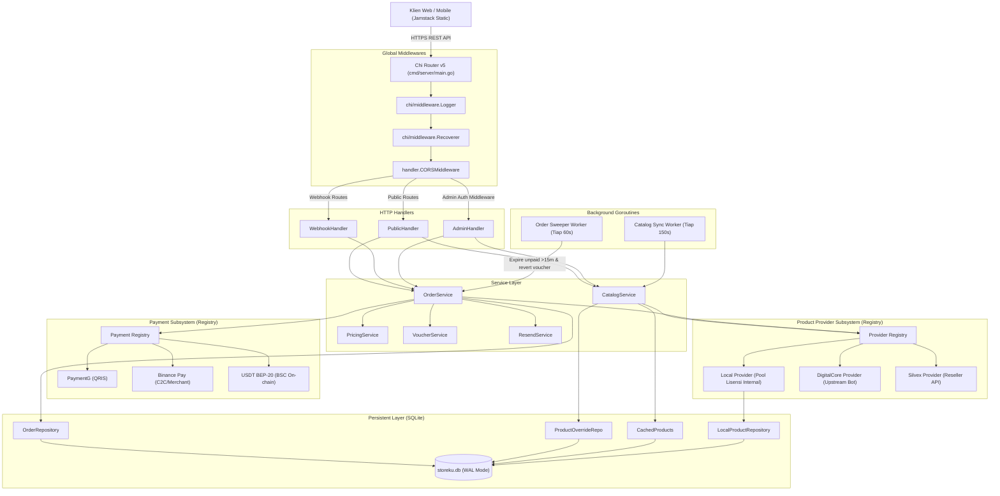

# Digimest Backend Architecture & Developer/Agent Guide

> **STATUS: LIVE PRODUCTION**  
> Backend service StoreKu / Digimest dibangun menggunakan **Golang 1.22+**, router [Chi v5](https://github.com/go-chi/chi), dan basis data embedded **SQLite** via driver pure Go [`modernc.org/sqlite`](https://gitlab.com/cznic/sqlite).  
> Service ini melayani REST API publik toko, webhook multi-payment gateway, background worker sinkronisasi produk, background sweeper kedaluwarsa pesanan, dan panel administrasi toko.

---

## 1. Navigasi Cepat Kode Backend (Quick File Navigator)

| Komponen / Domain | Lokasi File | Deskripsi & Simbol Kunci |
| :--- | :--- | :--- |
| **Server Entrypoint** | [`cmd/server/main.go`](file:///C:/laragon/www/storeku/cmd/server/main.go) | Bootstrap DB, registries, background goroutines, router Chi, graceful startup |
| **Konfigurasi & Env** | [`internal/config/config.go`](file:///C:/laragon/www/storeku/internal/config/config.go) | Struct [`Config`](file:///C:/laragon/www/storeku/internal/config/config.go#L10), fungsi `LoadConfig()`, fallback default env |
| **Database & Migrasi** | [`internal/database/db.go`](file:///C:/laragon/www/storeku/internal/database/db.go)<br>[`internal/database/migrations.go`](file:///C:/laragon/www/storeku/internal/database/migrations.go) | Inisialisasi SQLite PRAGMA (WAL, busy_timeout=5000), 8 tabel inti, safe `ALTER TABLE`, skema index |
| **Data Models** | [`internal/models/models.go`](file:///C:/laragon/www/storeku/internal/models/models.go)<br>[`internal/models/admin_login.go`](file:///C:/laragon/www/storeku/internal/models/admin_login.go) | Structs: `Order`, `Product`, `Voucher`, `Review`, `LocalProduct`, `ProductOverride`, `AdminLoginLog` |
| **Public API Handlers** | [`internal/handler/public_handler.go`](file:///C:/laragon/www/storeku/internal/handler/public_handler.go) | Handler: Katalog produk, detail, checkout, status order, claim serial, validasi voucher, ulasan |
| **Webhook Handlers** | [`internal/handler/webhook_handler.go`](file:///C:/laragon/www/storeku/internal/handler/webhook_handler.go) | Unified gateway receiver: QRIS (`PAYMENTG`), USDT BEP-20 (`BEP20`), Binance Pay (`BINANCE`) |
| **Admin Handlers** | [`internal/handler/admin_handler.go`](file:///C:/laragon/www/storeku/internal/handler/admin_handler.go)<br>[`internal/handler/admin_order_handler.go`](file:///C:/laragon/www/storeku/internal/handler/admin_order_handler.go)<br>[`internal/handler/admin_product_handler.go`](file:///C:/laragon/www/storeku/internal/handler/admin_product_handler.go)<br>[`internal/handler/admin_local_product_handler.go`](file:///C:/laragon/www/storeku/internal/handler/admin_local_product_handler.go)<br>[`internal/handler/admin_voucher_handler.go`](file:///C:/laragon/www/storeku/internal/handler/admin_voucher_handler.go)<br>[`internal/handler/admin_review_handler.go`](file:///C:/laragon/www/storeku/internal/handler/admin_review_handler.go)<br>[`internal/handler/admin_announcement_handler.go`](file:///C:/laragon/www/storeku/internal/handler/admin_announcement_handler.go)<br>[`internal/handler/admin_translation_handler.go`](file:///C:/laragon/www/storeku/internal/handler/admin_translation_handler.go)<br>[`internal/handler/admin_maintenance_handler.go`](file:///C:/laragon/www/storeku/internal/handler/admin_maintenance_handler.go)<br>[`internal/handler/admin_dashboard_handler.go`](file:///C:/laragon/www/storeku/internal/handler/admin_dashboard_handler.go) | Auth token admin, rate limiting brute-force login, manajemen produk/pesanan/voucher/banner/DB |
| **Security & Middleware** | [`internal/handler/middleware.go`](file:///C:/laragon/www/storeku/internal/handler/middleware.go)<br>[`internal/handler/login_limiter.go`](file:///C:/laragon/www/storeku/internal/handler/login_limiter.go) | CORS policy, Token-based Admin Auth header (`X-Admin-Token` / Bearer), Rate limiter per-IP |
| **Payment Registry** | [`internal/payment/registry.go`](file:///C:/laragon/www/storeku/internal/payment/registry.go)<br>[`internal/payment/gateway.go`](file:///C:/laragon/www/storeku/internal/payment/gateway.go) | Registry abstraksi multi-gateway (`Gateway` interface) |
| **Payment Adapters** | [`internal/payment/paymentg/adapter.go`](file:///C:/laragon/www/storeku/internal/payment/paymentg/adapter.go)<br>[`internal/payment/binance/adapter.go`](file:///C:/laragon/www/storeku/internal/payment/binance/adapter.go)<br>[`internal/payment/bep20/adapter.go`](file:///C:/laragon/www/storeku/internal/payment/bep20/adapter.go) | Implementasi PaymentG (QRIS), Binance C2C/Merchant, USDT BEP-20 (BSC on-chain scanner) |
| **Provider Registry** | [`internal/provider/registry.go`](file:///C:/laragon/www/storeku/internal/provider/registry.go)<br>[`internal/provider/provider.go`](file:///C:/laragon/www/storeku/internal/provider/provider.go) | Multi-provider registry (`Provider` interface) |
| **Provider Adapters** | [`internal/provider/local/local_provider.go`](file:///C:/laragon/www/storeku/internal/provider/local/local_provider.go)<br>[`internal/provider/digitalcore/adapter.go`](file:///C:/laragon/www/storeku/internal/provider/digitalcore/adapter.go)<br>[`internal/provider/silvex/adapter.go`](file:///C:/laragon/www/storeku/internal/provider/silvex/adapter.go) | Provider: Local pool serial keys, DigitalCore upstream bot API, Silvex reseller API |
| **Core Business Services** | [`internal/service/order_service.go`](file:///C:/laragon/www/storeku/internal/service/order_service.go)<br>[`internal/service/catalog_service.go`](file:///C:/laragon/www/storeku/internal/service/catalog_service.go)<br>[`internal/service/pricing_service.go`](file:///C:/laragon/www/storeku/internal/service/pricing_service.go)<br>[`internal/service/voucher_service.go`](file:///C:/laragon/www/storeku/internal/service/voucher_service.go)<br>[`internal/service/resend_service.go`](file:///C:/laragon/www/storeku/internal/service/resend_service.go) | State machine pesanan, fulfillment upstream/local, auto-expiration sweeper, in-memory cache prewarm + periodic sync, kalkulasi kurs USD/IDR, signature voucher, email pengiriman lisensi |
| **Repositories (DB Layer)** | [`internal/repository/order_repo.go`](file:///C:/laragon/www/storeku/internal/repository/order_repo.go)<br>[`internal/repository/product_override_repo.go`](file:///C:/laragon/www/storeku/internal/repository/product_override_repo.go)<br>[`internal/repository/local_product_repo.go`](file:///C:/laragon/www/storeku/internal/repository/local_product_repo.go)<br>[`internal/repository/voucher_repo.go`](file:///C:/laragon/www/storeku/internal/repository/voucher_repo.go)<br>[`internal/repository/review_repo.go`](file:///C:/laragon/www/storeku/internal/repository/review_repo.go)<br>[`internal/repository/setting_repo.go`](file:///C:/laragon/www/storeku/internal/repository/setting_repo.go)<br>[`internal/repository/maintenance_repo.go`](file:///C:/laragon/www/storeku/internal/repository/maintenance_repo.go)<br>[`internal/repository/admin_login_repo.go`](file:///C:/laragon/www/storeku/internal/repository/admin_login_repo.go) | Data Access Objects (DAO) berorientasi query SQL aman, transaksi atomic, pencegahan SQL Injection |

---

## 2. Topologi Arsitektur Sistem



---

## 3. Basis Data & Skema Tabel SQLite

Basis data disimpan dalam file SQLite lokal (default `storeku.db`) dengan konfigurasi performa tinggi di [`internal/database/db.go`](file:///C:/laragon/www/storeku/internal/database/db.go#L25-L30):
- `PRAGMA journal_mode = WAL;` (Write-Ahead Logging untuk read non-blocking konkuren)
- `PRAGMA busy_timeout = 5000;` (Retry hingga 5 detik jika file database terkunci saat write)
- `PRAGMA synchronous = NORMAL;` (Keseimbangan optimal integritas data dan kecepatan write)
- `PRAGMA foreign_keys = ON;` (Integritas relasional aktif)
- Pool koneksi: `db.SetMaxOpenConns(1)` (Pencegahan database lock error untuk write SQLite)

### Daftar 8 Tabel Inti:

#### 1. `orders` (Transaksi & Fulfillment)
Menyimpan seluruh lifecycle transaksi dari checkout hingga klaim:
- `id` (INTEGER PK AUTOINCREMENT)
- `invoice_number` (TEXT UNIQUE) — Format: `INV-YYYYMMDD-XXXXXX`
- `claim_code` (TEXT UNIQUE) — 8-12 karakter acak alfanumerik untuk akses lisensi tanpa login
- `product_slug`, `product_name`, `product_type`, `quantity`
- `base_price_usd` (REAL), `sell_price_idr` (INTEGER), `original_amount`, `unique_code`, `total_amount` (IDR)
- `gateway_order_id`, `qr_url` (URL gambar/string QRIS)
- `payment_status`: `PENDING`, `PAID`, `EXPIRED`, `CANCELLED`
- `fulfillment_status`: `PENDING`, `SUCCESS`, `FAILED`, `MANUAL`
- `fulfillment_error`, `digitalcore_order_id`, `digitalcore_view_url`
- `delivered_items` (TEXT JSON array): Berisi serial key atau kredensial akun terkirim `[{"item":"LICENSE_KEY"}]`
- `warranty_info`, `customer_contact` (WhatsApp/Telegram), `customer_email`
- `voucher_code`, `discount_idr`
- `payment_gateway` (`PAYMENTG`, `BINANCE`, `BEP20`), `payment_method` (`QRIS`, `USDT`, `BINANCE_PAY`), `payment_channel`
- Kolom Kripto/Binance: `crypto_amount_str`, `crypto_currency`, `binance_tx_id`, `binance_pay_id`, `binance_account_name`, `wallet_address`, `token_contract`, `network`, `tx_hash`, `cex_warning`
- Margin tracking: `cost_at_checkout_usd`, `cost_at_fulfillment_usd`
- Timestamp: `paid_at`, `expires_at` (15 menit sejak checkout), `created_at`, `updated_at`

#### 2. `settings` (Konfigurasi Dinamis Toko)
Pasangan key-value string:
- `key` (TEXT PK), `value` (TEXT)
- Kunci umum: `usd_to_idr_rate`, `profit_margin_percent`, `profit_margin_fixed`, `store_announcement`, `store_announcement_enabled`, `store_announcement_banner`, `store_announcement_link`.

#### 3. `product_overrides` (Kustomisasi Produk Katalog)
Mengubah harga, nama, visibilitas produk upstream:
- `product_slug` (TEXT PK)
- `custom_name`, `custom_type`, `custom_region`, `custom_warranty`
- `custom_stock` (-1: ikuti upstream, >=0: override manual)
- `custom_price_idr`, `promo_price_idr`, `baseline_modal_idr`
- `custom_description`, `custom_terms`, `custom_logo`
- Terjemahan EN: `custom_name_en`, `custom_type_en`, `custom_region_en`, `custom_warranty_en`, `custom_description_en`, `custom_terms_en`
- Kontrol: `is_active` (1/0), `is_force_out_of_stock` (1/0), `is_auto_suspended` (1/0)
- Visual etalase: `display_order` (urutan prioritas naik), `sales_count` (counter penjualan kosmetik)

#### 4. `cached_products` (Cache Sinkronisasi Upstream)
Menyimpan snapshot katalog upstream untuk respon instan < 1ms:
- `slug` (TEXT PK), `raw_id`, `name`, `type`, `logo`, `region`
- `stock`, `stock_capped`, `warranty`, `description`, `price_usd`
- `tiers_json` (TEXT JSON array untuk volume pricing)
- `last_fetched_at` (DATETIME)

#### 5. `local_products` (Produk Lisensi Stok Internal)
Produk yang tidak menggunakan provider upstream melainkan stok serial key sendiri:
- `id` (INTEGER PK AUTOINCREMENT), `slug` (TEXT UNIQUE), `name`, `type`, `logo`, `region`, `warranty`, `description`, `terms`
- Pasangan EN: `name_en`, `type_en`, `region_en`, `warranty_en`, `description_en`, `terms_en`
- Pricing: `price_idr`, `reference_price_idr`, `promo_price_idr`, `has_promo`, `discount_percent`
- Stok: `stock` (dihitung otomatis dari panjang `stock_keys`), `is_unlimited_stock` (1/0)
- `stock_keys` (TEXT JSON array serial lisensi, misal `["KEY-1", "KEY-2"]`)
- Kontrol: `is_active`, `is_force_out_of_stock`, `display_order`, `sales_count`

#### 6. `vouchers` (Kupon Diskon)
- `id` (INTEGER PK AUTOINCREMENT), `code` (TEXT UNIQUE)
- `discount_idr`, `min_spend_idr`, `max_usage`, `used_count`
- `expires_at`, `is_active`, `signature` (HMAC SHA-256 anti-tamper), `note`

#### 7. `product_reviews` (Testimoni & Ulasan)
- `id` (INTEGER PK AUTOINCREMENT), `product_slug`, `order_invoice`
- `author_name`, `rating` (1-5), `review_text`, `is_visible` (1/0)

#### 8. `admin_login_logs` (Audit Keamanan)
- `id` (INTEGER PK AUTOINCREMENT), `username`, `ip_address`, `user_agent`, `location`, `device_info`
- `status` (`SUCCESS` / `FAILED`), `failure_reason`, `login_at`

---

## 4. Konfigurasi Lingkungan (`.env`) & Setting Defaults

Struktur konfigurasi dimuat dari variabel sistem atau `.env` via [`internal/config/config.go`](file:///C:/laragon/www/storeku/internal/config/config.go):

| Variabel Env | Default Value | Keterangan & Tujuan |
| :--- | :--- | :--- |
| `PORT` | `8080` | Port listen HTTP server |
| `DATABASE_PATH` | `storeku.db` | File path basis data SQLite |
| `STORE_BASE_URL` | `https://digimest.tech` | URL kanonikal frontend toko |
| `ALLOWED_ORIGINS` | `https://digimest.tech,...` | Daftar domain yang diizinkan CORS (comma-separated) |
| `USD_TO_IDR_RATE` | `18000.0` | Nilai tukar acuan konversi USD ke IDR |
| `PROFIT_MARGIN_PERCENT`| `25.0` | Persentase margin keuntungan produk upstream |
| `PROFIT_MARGIN_FIXED` | `2000` | Tambahan margin flat (IDR) per transaksi |
| `ADMIN_USERNAME` | `admin` | Username login panel admin |
| `ADMIN_PASSWORD` | `admin123` | Password login panel admin |
| `ADMIN_SECRET_KEY` | `storeku_default_secret_key` | Secret key untuk enkripsi session/token auth |
| `VOUCHER_SECRET_KEY` | `voucher_sig_salt_default_key` | Salt HMAC verifikasi signature voucher |
| `DIGITALCORE_BASE_URL` | `https://digitalcore.top` | Base endpoint API provider DigitalCore |
| `DIGITALCORE_API_KEY` | `""` | API key provider DigitalCore |
| `SILVEX_BASE_URL` | `https://silvex-ai.com/api/...` | Base endpoint provider Silvex |
| `SILVEX_API_KEY` | `""` | API key provider Silvex |
| `PAYMENTG_API_URL` | `https://paymentg.syukurapi.online/...` | Endpoint sandbox/production PaymentG QRIS |
| `PAYMENTG_API_KEY` | `""` | Merchant API Key PaymentG QRIS |
| `PAYMENTG_BINANCE_API_URL`| `http://localhost:3300/...` | Endpoint gateway microservice Binance Pay |
| `PAYMENTG_BINANCE_API_KEY`| `""` | API Key Binance Pay |
| `PAYMENTG_BEP20_API_URL` | `http://localhost:3400` | Microservice validator USDT BEP-20 (BSC) |
| `PAYMENTG_BEP20_API_KEY` | `""` | API Key validator BEP-20 |
| `RESEND_API_KEY` | `""` | API key Resend untuk email delivery lisensi |
| `RESEND_FROM_EMAIL` | `Digimest <orders@digimest.tech>` | Sender address email notifikasi |
| `TELEGRAM_SUPPORT_USERNAME`| `Digimestsupport` | Username Telegram CS bantuan |

---

## 5. Matriks Lengkap REST API Endpoints

### A. Endpoint Publik & Toko (`/api/...`)
| Metode | Path | Handler | Deskripsi & Payload |
| :--- | :--- | :--- | :--- |
| `GET` | `/health` / `/api/health` | `HealthCheck` | Healthcheck server & uptime (200 OK) |
| `GET` | `/api/config` | `GetAppConfig` | Mengembalikan config publik (rate kurs, support telegram, payment channels) |
| `GET` | `/api/products` | `GetProducts` | Mengambil seluruh katalog produk aktif (tergabung upstream + local pool) |
| `GET` | `/api/products/{slug}` | `GetProductDetail` | Detail satu produk (termasuk deskripsi, terms, warranty, stok aktual) |
| `GET` | `/api/products/{slug}/reviews` | `GetProductReviews` | Daftar review terverifikasi untuk produk terkait |
| `POST` | `/api/reviews` | `SubmitReview` | Form kirim review baru oleh pembeli berdasar invoice valid |
| `POST` | `/api/vouchers/validate` | `ValidateVoucher` | Body: `{"code":"...", "subtotal":...}` → Response hitungan diskon |
| `POST` | `/api/checkout` | `CreateCheckout` | Body: `product_slug`, `quantity`, `customer_contact`, `customer_email`, `voucher_code`, `payment_method` (`QRIS`, `USDT`, `BINANCE_PAY`). Response: invoice, QR/Address, nominal unik, timer |
| `GET` | `/api/orders/{invoice}/status` | `GetOrderStatus` | Polling status pesanan (`payment_status`, `fulfillment_status`, `claim_code`, QR/wallet info) |
| `POST` | `/api/orders/{invoice}/check` | `TriggerCheck` | Pemicu manual pengecekan status ke gateway payment |
| `POST` | `/api/orders/{invoice}/cancel`| `CancelOrder` | Membatalkan pesanan pending oleh pembeli (voucher usage dikembalikan) |
| `GET` | `/api/claim` | `ClaimProduct` | Query: `?code=CLAIM_CODE` atau `?invoice=INV-...` → Lisensi & kredensial terkirim |
| `GET` | `/api/announcement` | `GetAnnouncement` | Mengambil banner pengumuman pop-up toko aktif |

### B. Endpoint Webhook Pembayaran (Tanpa Auth, Validasi Signature/Token)
| Metode | Path | Handler | Target Gateway |
| :--- | :--- | :--- | :--- |
| `POST` | `/webhook/paymentg`<br>`/api/webhook/paymentg` | `HandlePaymentGWebhook` | Gateway QRIS (PaymentG callback) |
| `POST` | `/webhook/{gateway}`<br>`/api/webhook/{gateway}` | `HandleGatewayWebhook` | Router dinamis gateway (`paymentg`, `binance`, `bep20`, `usdt_bep20`) |
| `POST` | `/payment/binance-webhook` | `HandleGatewayWebhook` | Khusus callback Binance Pay merchant |

### C. Endpoint Administrasi Terproteksi (`/api/admin/...`)
*Wajib menyertakan Header: `X-Admin-Token: <token>` atau `Authorization: Bearer <token>`.*

| Metode | Path | Handler | Deskripsi Fungsi |
| :--- | :--- | :--- | :--- |
| `POST` | `/api/admin/login` | `Login` | Autentikasi admin, rate-limited, catat audit log IP & User Agent |
| `POST` | `/api/admin/logout` | `Logout` | Invalidate token admin |
| `GET` | `/api/admin/stats` | `GetStats` | Metrik dashboard: omset harian/bulanan, total pesanan, margin profit |
| `GET` | `/api/admin/last-login` | `GetLastLogin` | Riwayat login terakhir administrator |
| `GET` | `/api/admin/security/logs` | `GetSecurityLogs` | Log audit aktivitas login dan status IP |
| `GET` | `/api/admin/security/stats`| `GetSecurityStats` | Statistik percobaan brute-force / login gagal |
| `GET` | `/api/admin/digitalcore/check`| `CheckDigitalCoreConnection` | Cek koneksi dan saldo bot DigitalCore upstream |
| `GET` | `/api/admin/silvex/check` | `CheckSilvexConnection` | Cek status koneksi dan saldo provider Silvex |
| `GET` | `/api/admin/silvex/products`| `ListSilvexProducts` | Daftar katalog raw dari provider Silvex |
| `GET` | `/api/admin/products` | `ListProducts` | Daftar seluruh produk (upstream terdaftar) dengan status override |
| `GET` | `/api/admin/etalase-products` | `ListEtalaseProducts` | Urutan dan visibilitas etalase produk |
| `POST` | `/api/admin/products/{slug}` | `SaveProductOverride` | Simpan override harga, stok custom, deskripsi, logo, diskon promo |
| `POST/DELETE` | `/api/admin/products/{slug}/reset` | `ResetProductOverride` | Menghapus override, kembali ke konfigurasi default upstream |
| `PUT` | `/api/admin/products/{slug}/display-stats` | `UpdateProductDisplayStats` | Ubah urutan tampil (`display_order`) dan jumlah terjual dummy (`sales_count`) |
| `GET/POST` | `/api/admin/custom-products` | `ListLocalProducts` / `CreateLocalProduct` | CRUD Produk Lokal (Stok serial internal) |
| `GET/PUT/DELETE`| `/api/admin/custom-products/{id}` | `GetLocalProduct` / `UpdateLocalProduct` / `DeleteLocalProduct` | Edit stok serial key array, nama EN/ID, status unlimited |
| `GET/POST` | `/api/admin/orders` | `ListOrders` | Daftar seluruh pesanan dengan filter status & pencarian invoice |
| `POST` | `/api/admin/retry` | `RetryFulfillment` | Ulangi pengiriman upstream order yang sempat gagal |
| `POST` | `/api/admin/orders/{invoice}/force-fulfill` | `ForceFulfill` | Paksa status pesanan menjadi SUCCESS dan minta serial ke upstream |
| `POST` | `/api/admin/orders/{invoice}/manual-paid-fulfill` | `ManualPaidAndFulfill` | Tandai pembayaran lunas manual lalu lakukan auto-fulfill |
| `POST` | `/api/admin/orders/{invoice}/manual-deliver-keys` | `ManualDeliverKeys` | Masukkan serial key lisensi secara manual langsung ke pesanan |
| `POST` | `/api/admin/orders/{invoice}/mark-refunded` | `MarkRefunded` | Ubah status order menjadi REFUNDED |
| `DELETE` | `/api/admin/orders/{invoice}` | `DeleteOrder` | Hapus riwayat order dari database |
| `GET/POST` | `/api/admin/vouchers` | `ListVouchers` / `CreateVoucher` | Manajemen kupon diskon |
| `POST` | `/api/admin/vouchers/{id}/toggle` | `ToggleVoucher` | Aktifkan/nonaktifkan voucher |
| `DELETE` | `/api/admin/vouchers/{id}` | `DeleteVoucher` | Hapus voucher dari sistem |
| `GET/POST/PUT/DELETE` | `/api/admin/reviews[/{id}]` | `ListReviews` / `CreateReview` / `UpdateReview` / `DeleteReview` | Moderasi dan pembuatan ulasan pembeli |
| `GET/POST` | `/api/admin/settings` | `GetSettings` / `SaveSettings` | Pengaturan rate dollar, margin keuntungan, telegram support |
| `GET/POST` | `/api/admin/announcement` | `GetAnnouncement` / `SaveAnnouncement` | Pengaturan teks, link, dan switch pop-up banner toko |
| `POST` | `/api/admin/announcement/upload` | `UploadAnnouncementBanner` | Upload file gambar banner toko |
| `GET/PUT` | `/api/admin/translations[/{slug}]` | `GetTranslations` / `UpdateTranslation` | Kelola string terjemahan bahasa Inggris produk |
| `POST` | `/api/admin/translations/auto-draft` | `AutoDraftTranslation` | Otomatis membuat draf terjemahan EN dari konten ID |
| `GET` | `/api/admin/maintenance/stats` | `GetDatabaseStats` | Ukuran file SQLite, jumlah baris tabel, log WAL |
| `POST` | `/api/admin/maintenance/clean` | `CleanDatabase` | Bersihkan pesanan expired lama, login logs, jalankan SQLite `VACUUM` |

---

## 6. Sub-Sistem Pembayaran (`internal/payment/`)

Arsitektur pembayaran dirancang berbasis **Registry Pattern** ([`internal/payment/registry.go`](file:///C:/laragon/www/storeku/internal/payment/registry.go)) sehingga penambahan payment gateway baru di masa depan tidak mengganggu alur order:

```go
type Gateway interface {
    ID() string
    CreateCharge(ctx context.Context, req *ChargeRequest) (*ChargeResponse, error)
    VerifyWebhook(r *http.Request) (*WebhookPayload, error)
    CheckStatus(ctx context.Context, gatewayOrderID string) (*StatusResponse, error)
}
```

### Gateway Terdaftar:
1. **`PAYMENTG`** ([`internal/payment/paymentg/adapter.go`](file:///C:/laragon/www/storeku/internal/payment/paymentg/adapter.go)):
   - Mode: QRIS Dinamis & Static Aggregator (ShopeePay, Dana, GoPay, BCA).
   - Menggunakan kode unik 3-digit (misal Rp 150.234) untuk verifikasi otomatis.
2. **`BINANCE`** ([`internal/payment/binance/adapter.go`](file:///C:/laragon/www/storeku/internal/payment/binance/adapter.go)):
   - Mode: Binance Pay ID / Merchant C2C.
   - Alias: `PAYMENTG_BINANCE`.
3. **`USDT_BEP20`** ([`internal/payment/bep20/adapter.go`](file:///C:/laragon/www/storeku/internal/payment/bep20/adapter.go)):
   - Mode: Transfer kripto on-chain jaringan BNB Smart Chain (BSC BEP-20).
   - Memantau smart contract USDT dan transaction hash explorer BscScan.
   - Alias: `BEP20`, `PAYMENTG_BEP20`.

---

## 7. Sub-Sistem Provider Produk (`internal/provider/`)

Arsitektur produk menggunakan abstraksi multi-sumber via [`internal/provider/provider.go`](file:///C:/laragon/www/storeku/internal/provider/provider.go):

1. **`local`** ([`internal/provider/local/local_provider.go`](file:///C:/laragon/www/storeku/internal/provider/local/local_provider.go)):
   - Mengambil stok dari tabel `local_products` (kolom `stock_keys`).
   - Saat pembayaran lunas, sistem mengambil 1 lisensi teratas secara atomik (FIFO) dari array JSON, memotong stok, dan menyimpannya di `delivered_items`.
2. **`digitalcore`** ([`internal/provider/digitalcore/adapter.go`](file:///C:/laragon/www/storeku/internal/provider/digitalcore/adapter.go)):
   - Integrasi upstream bot API.
   - Normalizer mengubah format payload upstream menjadi struktur baku `models.Product`.
   - Mengirim pesanan otomatis ke bot saat order status berubah menjadi `PAID`.
3. **`silvex`** ([`internal/provider/silvex/adapter.go`](file:///C:/laragon/www/storeku/internal/provider/silvex/adapter.go)):
   - Integrasi reseller API pihak ketiga Silvex AI.

---

## 8. Layanan Bisnis & Background Workers

### A. Catalog Sync Worker (`internal/service/catalog_service.go`)
- **Prewarm Cache**: Saat aplikasi baru start (`catalogService.PrewarmCache()`), data produk langsung dibaca dari tabel `cached_products` SQLite ke memory RAM. Akibatnya, request pertama pengunjung menerima respon katalog dalam < 1 milidetik tanpa menunggu handshake jaringan upstream.
- **Background Worker**: Goroutine berjalan non-blocking setiap 150 detik (`150*time.Second`) memfetch katalog terbaru dari seluruh provider terdaftar, memperbarui harga modal, dan menyimpannya kembali ke SQLite.

### B. Order Sweeper Worker (`cmd/server/main.go` & `order_service.go`)
- Background goroutine berjalan setiap 1 menit (`1*time.Minute`).
- Mencari seluruh pesanan dengan `payment_status = 'PENDING'` yang telah melewati `expires_at` (15 menit sejak checkout).
- Mengubah status pesanan menjadi `EXPIRED`.
- Mengembalikan kuota kupon diskon (`voucher_service.RevertUsage(order.VoucherCode)`).

### C. State Machine Siklus Pesanan (`OrderService`)
```text
[CHECKOUT] -> payment_status: PENDING, fulfillment_status: PENDING
      │
      ├── (Batal oleh user atau Sweeper > 15m) -> payment_status: EXPIRED/CANCELLED
      │                                            └─ Revert Voucher Kuota
      │
      └── (Webhook / Cek Gateway: LUNAS)
            │
            ▼
      payment_status: PAID
            │
            ├── Provider == "local" ─────► Ambil Serial dari `stock_keys` SQLite
            │                              └─ fulfillment_status: SUCCESS
            │
            └── Provider == Upstream ────► Request order ke Bot API
                                           ├── Sukses ──► fulfillment_status: SUCCESS
                                           │              Kirim Email Lisensi via Resend
                                           └── Gagal  ──► fulfillment_status: FAILED / MANUAL
                                                          Simpan `fulfillment_error`
                                                          Tampilkan panduan hubungi CS
```

---

## 9. Panduan Perintah Operasional & Pengujian Backend

### Menjalankan Server Lokal
```powershell
# Jalankan langsung dari root
go run ./cmd/server
```

### Kompilasi Binary Produksi
```powershell
# Pastikan 0 compile error sebelum deploy
go build ./...

# Build binary tunggal produksi Windows
go build -ldflags="-s -w" -o digimest-server.exe ./cmd/server

# Build binary Linux ELF untuk deployment VPS
$env:GOOS="linux"; $env:GOARCH="amd64"; go build -ldflags="-s -w" -o digimest-server-linux ./cmd/server
```

### Menjalankan Unit & Integration Tests
```powershell
# Jalankan seluruh test suite Go
go test ./...

# Jalankan test khusus handler atau database
go test -v ./internal/database
go test -v ./internal/handler
```

---

## 10. Pantangan Mutlak untuk AI Agents (Zero-Regression Guardrails)

1. **JANGAN UBAH PRAGMA SQLITE**: Konfigurasi `PRAGMA journal_mode = WAL;` dan `db.SetMaxOpenConns(1)` adalah kunci stabilitas SQLite untuk mencegah error `database is locked`. Jangan pernah mengubah `SetMaxOpenConns` menjadi lebih dari 1 tanpa pemisahan reader/writer yang teruji.
2. **KONTRAK JSON API HARUS SINKRON DENGAN FRONTEND**: Jangan pernah mengganti tag `json:"..."` pada struct [`internal/models/models.go`](file:///C:/laragon/www/storeku/internal/models/models.go) atau payload response handler tanpa memeriksa frontend di `web/js/`.
3. **TRANSAKSI VOUCHER ATOMIK**: Selalu gunakan fungsi `voucherService.ApplyVoucher()` dan `voucherService.RevertUsage()` saat pesanan dibuat, dibatalkan, atau kedaluwarsa untuk mencegah kebocoran kuota kupon.
4. **INTEGRITAS CLAIM CODE**: Kolom `claim_code` pada pesanan adalah kredensial privasi bagi pembeli untuk mengambil lisensi di halaman `/claim.html`. Jangan pernah membocorkan `claim_code` di endpoint list publik.
