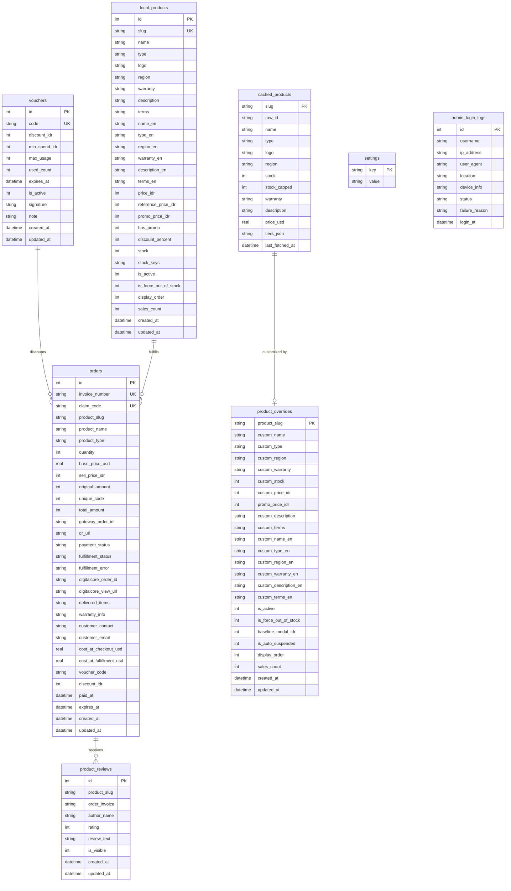
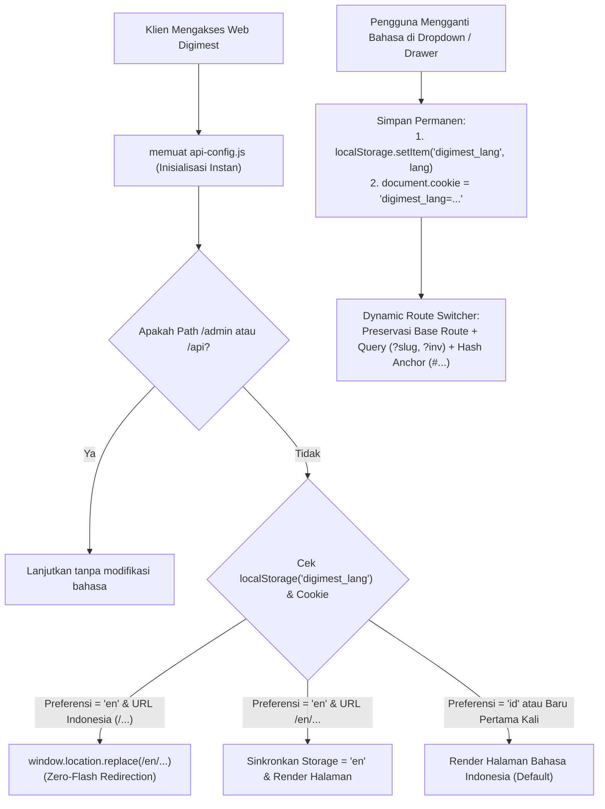

# 💎 Digimest — Platform E-Commerce Produk Digital & Lisensi Otomatis (v5.9.5)

**Digimest** (`https://digimest.tech` / VPS: `https://digimest.syukurapi.online`) adalah platform e-commerce otomatisasi tingkat produksi (*production-grade*) untuk distribusi lisensi digital, software serial keys, voucher game, dan akun streaming premium. Platform ini beroperasi secara mandiri 24/7 tanpa intervensi manual, mengintegrasikan gateway pembayaran QRIS otomatis (**PaymentG**) dan penyedia stok lisensi upstream (**DigitalCore**), serta inventaris produk lokal mandiri.

Dokumen ini disusun sebagai **Master Arsitektur & Spesifikasi Teknis Definitif (v5.9.5)** agar setiap pengembang perangkat lunak maupun agen AI (*AI coding agents*) di masa depan dapat memahami 100% arsitektur, data dictionary, seluruh modul panel admin, dan seluruh *logic gate* yang mengendalikan sistem ini.

---

## 📑 Daftar Isi
1. [Tech Stack & Topologi Arsitektur](#1-tech-stack--topologi-arsitektur)
2. [Submodule Git & Alur Sinkronisasi Frontend](#2-submodule-git--alur-sinkronisasi-frontend)
3. [Kamus Data & Skema Database SQLite (8 Tabel)](#3-kamus-data--skema-database-sqlite-8-tabel)
4. [Arsitektur Frontend & Multi-Bahasa Permanen (ID & EN)](#4-arsitektur-frontend--multi-bahasa-permanen-id--en)
5. [Alur Bisnis End-to-End & State Machine](#5-alur-bisnis-end-to-end--state-machine)
6. [Bedah Detail Panel Admin & 100% Logic Gates (10 Modul)](#6-bedah-detail-panel-admin--100-logic-gates-10-modul)
7. [Referensi Lengkap REST API (37 Endpoints)](#7-referensi-lengkap-rest-api-37-endpoints)
8. [Aturan Teknis & Guardrails untuk Agen AI / Developer](#8-aturan-teknis--guardrails-untuk-agen-ai--developer)
9. [Panduan Menjalankan, Testing & Kompilasi](#9-panduan-menjalankan-testing--kompilasi)
10. [Pohon Direktori Repositori](#10-pohon-direktori-repositori)

---

## 1. Tech Stack & Topologi Arsitektur

Platform Digimest dibangun dengan filosofi **Zero-Overhead, High-Performance, Minimalist Dependencies**:

```
┌────────────────────────────────────────────────────────────────────────────────────────┐
│                                   CLIENT LAYER (Browser)                                │
│   • Multi-Language Routing: Indonesia (/) & English (/en/)                             │
│   • Zero-Flash Header Script (api-config.js) • Permanent Language Session               │
│   • Vanilla HTML5 / CSS3 Glassmorphism / Modern ES6 (Zero Build Tools / No NPM)       │
│   • Offline LocalStorage Order History Sync & 15-Minute Expiration Auditor              │
└───────────────────────────────────────────▲────────────────────────────────────────────┘
                                            │ HTTPS / Clean URLs (REST)
┌───────────────────────────────────────────▼────────────────────────────────────────────┐
│                             EDGE & TUNNEL LAYER (Cloudflare)                           │
│   • Cloudflare Edge (Auto-SSL, DDoS Mitigation, Edge Caching Policy)                   │
│   • Cloudflare Tunnel Daemon (cloudflared): Outbound Encrypted Tunnel (No Open Ports)  │
└───────────────────────────────────────────▲────────────────────────────────────────────┘
                                            │ HTTP (localhost:8080)
┌───────────────────────────────────────────▼────────────────────────────────────────────┐
│                                BACKEND LAYER (Go 1.22+)                                │
│   • Lightweight Router: go-chi/chi/v5 • CORS Handler • HMAC-SHA256 Auth Middleware     │
│   • Background Sweeper Worker (1-Min Expired Orders Cleanup)                           │
│   • Memory Cache RWMutex (45s TTL Upstream Catalog with Graceful Fallback)             │
│   • Pure Go Single-Writer Connection Pool (modernc.org/sqlite, CGO_ENABLED=0)          │
└───────────────┬───────────────────────────┬───────────────────────────┬────────────────┘
                │                           │                           │
                ▼                           ▼                           ▼
    ┌───────────────────────┐   ┌───────────────────────┐   ┌───────────────────────┐
    │       PaymentG        │   │      DigitalCore      │   │      Resend.com       │
    │  Gateway QRIS Otomatis│   │  Upstream License API │   │   Transactional Email │
    │  (Kode Unik 3 Digit)  │   │  (Instant Auto-Buy)   │   │  (Serial Key Delivery)│
    └───────────────────────┘   └───────────────────────┘   └───────────────────────┘
```

### Spesifikasi Komponen:
* **Backend:** Bahasa pemrograman **Go (Golang) 1.22+** menggunakan router [`go-chi/chi/v5`](https://github.com/go-chi/chi).
* **Database:** **SQLite** menggunakan driver pure Go [`modernc.org/sqlite`](https://gitlab.com/cznic/sqlite) tanpa membutuhkan runtime CGO (`CGO_ENABLED=0`).
* **Frontend:** **Vanilla HTML5, CSS3, dan Vanilla JavaScript (ES6)** tanpa framework bundler (tanpa React, Vue, Webpack, Vite, atau Node.js). Berjalan langsung (*zero build step*) di browser klien.
* **Integrasi Eksternal:**
  * **PaymentG:** Penyedia gateway pembayaran QRIS dengan pencocokan kode unik 3 digit (100–999) dan batas waktu kedaluwarsa 15 menit.
  * **DigitalCore:** Server upstream penyedia katalog lisensi software dan bot pemenuhan instan.
  * **Resend:** Layanan pengiriman email transaksional untuk mengirimkan kode invoice, kode klaim, dan serial key langsung ke email pembeli.

---

## 2. Submodule Git & Alur Sinkronisasi Frontend

Digimest menerapkan arsitektur pemisahan repositori frontend dan backend untuk menjaga modularitas:

1. **Direktori Pengembangan (`scratch_fe/`):**
   * Merupakan **Git Submodule** independen (`scratch_fe`).
   * Seluruh modifikasi kode HTML, CSS, JavaScript, aset gambar, dan konfigurasi versi (`version.json`) **WAJIB** dilakukan pada folder `scratch_fe/`.
2. **Direktori Produksi (`web/`):**
   * Merupakan direktori mirror statis yang disajikan langsung oleh backend Go Chi melalui `http.FileServer`.
   * Folder ini tercantum dalam `.gitignore` pada repositori root.
3. **Alur Sinkronisasi:**
   Setiap kali ada perubahan di `scratch_fe/`, file disinkronkan ke `web/`:
   ```powershell
   Copy-Item -Path scratch_fe\* -Destination web -Recurse -Force
   ```
4. **Strategi Cache-Busting Versi Aplikasi (`v5.9.5`):**
   * `scratch_fe/version.json`: Menyimpan nomor versi, stempel waktu build, dan tanggal rilis.
   * `scratch_fe/js/api-config.js`: Mendefinisikan `window.STOREKU_BUILD_VERSION = '5.9.5'`.
   * Seluruh tag `<link>` stylesheet dan `<script>` di-append query parameter `?v=5.9.5`.
   * Modul background `initVersionWatcher()` memeriksa `/version.json` setiap 60 detik saat tab kembali aktif. Jika terdeteksi versi baru di server, browser klien otomatis melakukan *hard reload* (`window.location.reload(true)`).

---

## 3. Kamus Data & Skema Database SQLite (8 Tabel)

Database disimpan pada file `storeku.db`. Koneksi diatur dengan pragma:
```sql
PRAGMA journal_mode = WAL;
PRAGMA busy_timeout = 5000;
PRAGMA synchronous = NORMAL;
```
Pool koneksi dikonfigurasi `db.SetMaxOpenConns(1)` untuk menjamin keamanan penulisan (*single-writer pattern*), menghindari *database locked error*.



### Rincian 8 Tabel SQLite:

#### 1. Tabel `orders` (Data Transaksi & Pemenuhan Lisensi)
Menyimpan riwayat transaksi finansial pembeli, detail QRIS, dan serial keys:
* `id` (INTEGER PK): Auto-increment.
* `invoice_number` (TEXT UNIQUE): Format `INV-YYYYMMDD-XXXXXX` (6 karakter acak).
* `claim_code` (TEXT UNIQUE): Format `CLM-XXXXXX` (hanya dibocorkan ke pembeli jika status `PAID`).
* `product_slug` (TEXT): Identifier produk (baik dari DigitalCore atau Local).
* `product_name`, `product_type` (TEXT): Nama & kategori produk.
* `quantity` (INTEGER): Jumlah item dibeli (1–100).
* `base_price_usd` (REAL): Modal upstream per item saat checkout.
* `sell_price_idr` (INTEGER): Harga jual satuan sebelum voucher.
* `original_amount` (INTEGER): Subtotal pesanan setelah diskon voucher (tanpa kode unik).
* `unique_code` (INTEGER): Angka acak 3 digit (100–999) dari gateway untuk verifikasi mutasi.
* `total_amount` (INTEGER): Nominal transfer akhir wajib pas (`original_amount + unique_code`).
* `voucher_code` (TEXT): Kode voucher yang digunakan (opsional).
* `discount_idr` (INTEGER): Potongan voucher dalam rupiah.
* `gateway_order_id` (TEXT): ID tagihan resmi dari PaymentG.
* `qr_url` (TEXT): URL gambar QRIS dinamis.
* `payment_status` (TEXT): `PENDING`, `PAID`, `EXPIRED`, `CANCELLED`, `REFUNDED`.
* `fulfillment_status` (TEXT): `PENDING`, `SUCCESS`, `HOLD_PRICE_SPIKE`, `HOLD_INSUFFICIENT_BOT_BALANCE`, `PENDING_MANUAL_DELIVERY`, `FAILED`, `REFUNDED`.
* `fulfillment_error` (TEXT): Pesan teknis jika terjadi penahanan atau kegagalan pemenuhan.
* `digitalcore_order_id` (TEXT): ID transaksi pembelian di DigitalCore.
* `digitalcore_view_url` (TEXT): Link verifikasi serial key upstream.
* `delivered_items` (TEXT): JSON array serial keys / lisensi (contoh: `["KEY-1", "KEY-2"]`).
* `warranty_info` (TEXT): Deskripsi garansi produk saat dibeli.
* `customer_contact` (TEXT): Kontak WhatsApp / Telegram pembeli.
* `customer_email` (TEXT): Email pembeli untuk pengiriman notifikasi Resend.
* `cost_at_checkout_usd` (REAL): Estimasi modal saat invoice dibuat.
* `cost_at_fulfillment_usd` (REAL): Modal riil saat dieksekusi auto-buy ke upstream.
* `paid_at` (DATETIME): Stempel waktu pelunasan (Wajib UTC).
* `expires_at` (DATETIME): Batas waktu bayar 15 menit (Wajib UTC).
* `created_at`, `updated_at` (DATETIME): Stempel waktu pembuatan dan pembaruan (UTC).

#### 2. Tabel `settings` (Konfigurasi Global Toko)
Format key-value sederhana:
* `usd_rate`: Nilai tukar 1 USD ke IDR (contoh: `18000`).
* `margin_percent`: Persentase profit dasar (contoh: `25` untuk 25%).
* `margin_fixed`: Biaya operasional tetap per item dalam rupiah (contoh: `2000`).
* `max_surge_disable_percent`: Batas kenaikan modal upstream sebelum produk otomatis disuspend (contoh: `50`).
* `telegram_cs_username`: Username Telegram Customer Service (contoh: `Digimestsupport`).

#### 3. Tabel `product_overrides` (Kustomisasi Produk Upstream DigitalCore)
Mengontrol penyesuaian harga, promosi, dan translasi produk DigitalCore:
* `product_slug` (TEXT PK): Slug produk DigitalCore.
* `custom_name`, `custom_type`, `custom_region`, `custom_warranty`: Override teks bahasa Indonesia.
* `custom_name_en`, `custom_type_en`, `custom_region_en`, `custom_warranty_en`, `custom_description_en`, `custom_terms_en`: Override teks bahasa Inggris.
* `custom_price_idr`: Harga jual tetap kustom (mengabaikan rumus kurs jika diisi > 0).
* `promo_price_idr`: Harga promosi diskon (menghasilkan badge promo `-X%`).
* `custom_stock`: Override stok manual (`-1` = passthrough live stock DigitalCore, `0` = habis, `>0` = stok kustom).
* `is_active`: `1` (tampil di etalase) atau `0` (disembunyikan).
* `is_force_out_of_stock`: `1` (paksa status habis manual oleh admin).
* `baseline_modal_idr`: Harga modal dasar tersimpan untuk kalkulasi proteksi lonjakan harga (*surge protection*).
* `is_auto_suspended`: `1` jika modal upstream naik melebihi batas toleransi.
* `display_order`: Urutan prioritas tampil di katalog etalase (angka lebih kecil tampil lebih atas).
* `sales_count`: Angka *social proof* terjual yang ditampilkan ke publik.

#### 4. Tabel `cached_products` (Cache Etalase DigitalCore)
Penyimpanan persisten lokal untuk katalog upstream guna menjamin toko tetap online saat terjadi gangguan jaringan upstream (*micro-outage*):
* `slug` (TEXT PK), `raw_id`, `name`, `type`, `logo`, `region`, `stock`, `stock_capped`, `warranty`, `description`, `price_usd`.
* `tiers_json` (TEXT): Array JSON harga grosir per kuantitas `[{"min_qty":1,"max_qty":5,"price_usd":2.5}, ...]`.
* `last_fetched_at` (DATETIME): Waktu sinkronisasi terakhir.

#### 5. Tabel `admin_login_logs` (Audit Jejak Keamanan Admin)
Mencatat seluruh upaya autentikasi ke panel admin:
* `id` (INTEGER PK), `username`, `ip_address`, `user_agent`, `location`, `device_info`.
* `status` (TEXT): `SUCCESS` atau `FAILED`.
* `failure_reason` (TEXT): Alasan penolakan (contoh: `Invalid secret key`, `Rate limit exceeded`).
* `login_at` (DATETIME): Waktu percobaan login (UTC).

#### 6. Tabel `vouchers` (Kupon Diskon)
* `id` (INTEGER PK), `code` (TEXT UNIQUE, uppercase).
* `discount_idr` (INTEGER): Nominal potongan harga dalam IDR.
* `min_spend_idr` (INTEGER): Syarat minimum total belanja.
* `max_usage` (INTEGER): Kuota maksimal pemakaian kupon.
* `used_count` (INTEGER): Jumlah kuota yang telah terkonsumsi.
* `expires_at` (DATETIME): Batas tanggal kedaluwarsa kupon.
* `is_active` (INTEGER): `1` (aktif) atau `0` (dinonaktifkan).
* `signature` (TEXT): HMAC-SHA256 digital signature untuk validasi integritas data kupon.
* `note` (TEXT): Catatan internal admin.

#### 7. Tabel `local_products` (Produk Lokal Mandiri)
Katalog produk yang dikelola internal tanpa bergantung pada provider DigitalCore:
* `id` (INTEGER PK), `slug` (TEXT UNIQUE).
* `name`, `type`, `logo`, `region`, `warranty`, `description`, `terms`: Metadata bahasa Indonesia.
* `name_en`, `type_en`, `region_en`, `warranty_en`, `description_en`, `terms_en`: Metadata bahasa Inggris.
* `price_idr`, `reference_price_idr`, `promo_price_idr`, `has_promo`, `discount_percent`.
* `stock_keys` (TEXT): JSON array kunci lisensi siap kirim `["KEY-ABC", "KEY-XYZ"]`.
* `stock` (INTEGER): Dihitung otomatis dari `len(stock_keys)`.
* `is_active`, `is_force_out_of_stock`, `display_order`, `sales_count`.

#### 8. Tabel `product_reviews` (Ulasan & Rating Pembeli)
* `id` (INTEGER PK), `product_slug` (TEXT), `order_invoice` (TEXT): Terikat pada invoice lunas.
* `author_name` (TEXT): Nama pembeli.
* `rating` (INTEGER): Skor bintang (1 sampai 5).
* `review_text` (TEXT): Ulasan teks pembeli.
* `is_visible` (INTEGER): `1` (ditampilkan di web publik) atau `0` (disembunyikan oleh admin).

---

## 4. Arsitektur Frontend & Multi-Bahasa Permanen (ID & EN)

Digimest menerapkan arsitektur *dual-directory routing* yang didukung sistem retensi bahasa permanen:



### 1. Struktur URL Bersih (Clean URLs)
* **Versi Bahasa Indonesia:**
  `/` (Katalog), `/product?slug=...` (Detail), `/payment?inv=...` (Invoice QRIS), `/claim?code=...` (Klaim Lisensi), `/about` (Tentang), `/how-to-buy` (Panduan), `/warranty` (Garansi), `/privacy` (Privasi), `/terms` (Syarat Ketentuan).
* **Versi Bahasa Inggris:**
  `/en/` (Catalog), `/en/product?slug=...` (Detail), `/en/payment?inv=...` (Invoice QRIS), `/en/claim?code=...` (Claim License), `/en/about` (About), `/en/how-to-buy` (Guide), `/en/warranty` (Warranty), `/en/privacy` (Privacy), `/en/terms` (Terms).
* **Permanent Redirects 301:** Seluruh request berakhiran `.html` (misal `/about.html`, `/en/how-to-buy.html`) otomatis dialihkan dengan HTTP 301 ke URL bersihnya.

### 2. Multi-Layer Language Protection (Zero-Flash & Permanent)
* **Layer 1 (Immediate `<head>` Router):** Script [`scratch_fe/js/api-config.js`](file:///C:/laragon/www/storeku/scratch_fe/js/api-config.js) dieksekusi di dalam `<head>` sebelum DOM dirender. Jika pembeli sebelumnya telah memilih bahasa Inggris, script langsung mengalihkan rute tanpa memunculkan kedipan (*flash*) konten bahasa Indonesia.
* **Layer 2 (Permanent Persistence):** Setiap klik bahasa pada dropdown navbar maupun drawer mobile menyimpan nilai secara permanen ke `localStorage` dan cookie berdurasi 1 tahun (`max-age=31536000`).
* **Layer 3 (Dynamic Route Switcher):** Pergantian bahasa mengekstrak `baseRoute` sehingga pengguna tetap berada di halaman yang sama persis beserta seluruh parameter query (`?slug=...`, `?inv=...`, `?code=...`) dan hash anchor (`#...`). Pengguna **tidak akan pernah mental ke beranda**.
* **Layer 4 (Client-Side Link Enforcer):** Pada event `DOMContentLoaded` di halaman English, script [`order-history.js`](file:///C:/laragon/www/storeku/scratch_fe/js/order-history.js) secara otomatis memindai seluruh tag `<a>` internal untuk memastikan tidak ada link lokal yang tertinggal tanpa awalan `/en`.

### 3. Modul Riwayat Pesanan Offline (LocalStorage Order History)
* Seluruh transaksi yang dilakukan pembeli disimpan di browser lokal melalui key `digimest_saved_orders`.
* Pembeli dapat melihat status pesanan, waktu kedaluwarsa 15 menit, dan membuka kembali lisensi produk kapan saja tanpa perlu mendaftar atau login akun (*zero barrier to entry*).

---

## 5. Alur Bisnis End-to-End & State Machine

```mermaid
sequenceDiagram
    autonumber
    actor Buyer as Pembeli (User)
    participant Browser as Frontend Web (v5.9.5)
    participant Backend as Go Backend Chi (:8080)
    participant SQLite as Database SQLite
    participant PaymentG as Gateway QRIS (PaymentG)
    participant Upstream as Provider Stok (DigitalCore / Local)
    participant Mailer as Resend Email Service

    Buyer->>Browser: 1. Buka Detail Produk & Isi Email Checkout
    Browser->>Backend: 2. POST /api/checkout (Slug, Qty, Email, Voucher)
    
    rect rgb(20, 25, 40)
        Note over Backend,SQLite: Logika Validasi & Kalkulasi Harga
        Backend->>SQLite: Validasi Kuota Voucher & Ketersediaan Stok
        Backend->>PaymentG: Request Tagihan QRIS (Nominal + 3-Digit Unique Code)
        PaymentG-->>Backend: Return QR URL, ID Transaksi & Expiry 15 Menit
        Backend->>SQLite: INSERT INTO orders (Status: PENDING)
    end
    
    Backend-->>Browser: 3. Return JSON Checkout (Redirect ke /payment?inv=INV-xxx)
    Browser->>Buyer: 4. Tampilkan Gambar QRIS & Timer Hitung Mundur 15 Menit
    
    Buyer->>PaymentG: 5. Scan QRIS Melalui m-Banking / e-Wallet (Nominal Pas)
    
    alt Skenario A: Webhook Otomatis dari PaymentG
        PaymentG->>Backend: POST /api/webhook/paymentg (Event: PAID, ShopeeTxID)
    else Skenario B: Pembeli Klik "Saya Sudah Bayar" (Instant Polling)
        Buyer->>Browser: Klik "Saya Sudah Bayar (Cek Mutasi Sekarang)"
        Browser->>Backend: POST /api/orders/{invoice}/check
        Backend->>PaymentG: Trigger Mutation Check & CheckOrderStatus()
    end

    rect rgb(20, 35, 25)
        Note over Backend,Upstream: State Machine Pemenuhan Lisensi (Fulfillment)
        Backend->>SQLite: UPDATE orders SET payment_status = 'PAID', paid_at = UTC
        
        alt Produk Lokal (Local Product)
            Backend->>SQLite: ClaimKeys(slug, qty) dari stock_keys
            alt Stok Key Tersedia
                SQLite-->>Backend: Return Keys
                Backend->>SQLite: UPDATE fulfillment_status = 'SUCCESS'
            else Stok Key Kosong
                Backend->>SQLite: UPDATE fulfillment_status = 'PENDING_MANUAL_DELIVERY'
            end
        else Produk Upstream (DigitalCore)
            Backend->>Upstream: Cek Modal Riil & Saldo Bot ($)
            alt Terjadi Lonjakan Modal Ekstrem (Surge Protection)
                Backend->>SQLite: UPDATE fulfillment_status = 'HOLD_PRICE_SPIKE'
            else Saldo Bot Upstream Tidak Cukup
                Backend->>SQLite: UPDATE fulfillment_status = 'HOLD_INSUFFICIENT_BOT_BALANCE'
            else Kondisi Normal & Saldo Cukup
                Backend->>Upstream: POST /buy (Slug, Quantity)
                Upstream-->>Backend: Return Serial Keys & Order ID
                Backend->>SQLite: UPDATE fulfillment_status = 'SUCCESS'
            end
        end
        
        Backend->>Mailer: Kirim Email Notifikasi & Kode Klaim via Resend
    end

    Browser->>Backend: 6. Polling Status: GET /api/orders/{invoice}/status
    Backend-->>Browser: 7. Status PAID & SUCCESS: Tampilkan Serial Key di Layar
    Buyer->>Browser: 8. Salin Serial Key / Buka Halaman /claim / Beri Rating Review
```



### Formula Penetapan Harga Produk Upstream:
$$\text{Harga Jual IDR} = \text{RoundTo100}\left((\text{Harga USD} \times \text{Kurs}) \times (1 + \frac{\text{Margin}\%}{100}) + \text{Margin Tetap}\right)$$
* **Golden Rule Safety Check:** Harga jual yang ditagihkan kepada pembeli **tidak boleh lebih rendah** daripada harga modal aman terkini:
  $$\text{MinSafePrice} = \text{ConvertUSDToIDR}(\text{Harga USD Live}) \times (1 + \frac{\text{Margin}\%}{100})$$
* **Proteksi Saldo Bot (Surge Protection Gate):** Saat pembayaran diverifikasi, backend mengecek kembali harga modal live di DigitalCore. Jika modal naik melebihi nominal pembayaran yang diterima pembeli, eksekusi auto-buy **langsung dihentikan (HOLD_PRICE_SPIKE)** untuk mencegah kerugian saldo bot.

---

## 6. Bedah Detail Panel Admin & 100% Logic Gates (10 Modul)

Panel admin dapat diakses melalui URL `/admin` dan dilindungi oleh otentikasi sesi berbasis cookie terenkripsi HMAC.

```
┌────────────────────────────────────────────────────────────────────────┐
│                        DIGIMEST ADMIN PANEL (v5.9.5)                   │
├───────────────────┬────────────────────────────────────────────────────┤
│ 1. Login          │ Otentikasi AdminSecretKey, Rate Limiting & Audit   │
│ 2. Dashboard      │ Omset, Breakdown Status Pesanan & Saldo Bot USD    │
│ 3. Produk Upstream│ Katalog DigitalCore, Surge, Promo & Stok Override  │
│ 4. Produk Lokal   │ Manajemen Stok Serial Keys Mandiri & Depletion     │
│ 5. Terjemahan     │ Dual-Language Editor (ID & EN) & Auto-Draft Engine │
│ 6. Pesanan        │ Filter Transaksi, Retry, Force Fulfill, Refund     │
│ 7. Kupon Diskon   │ Kode Promo, HMAC Signature, Min-Spend & Quota      │
│ 8. Ulasan Pembeli │ Moderasi Testimoni Terikat Invoice Lunas           │
│ 9. Keamanan Bot   │ Audit Log Login, IP Attacker & Deteksi Anomali     │
│ 10. Pengaturan    │ Kurs USD, Margin Profit, Kontak CS & Maintenance   │
└───────────────────┴────────────────────────────────────────────────────┘
```

### Modul 1: Login & Otentikasi (`/admin/login`)
* **Logic Gate 1 (Kredensial):** Nilai input dicocokkan dengan `cfg.AdminSecretKey` dari file `.env`.
* **Logic Gate 2 (Rate Limiting):** Membatasi percobaan login maksimal per IP address untuk menangkis serangan brute force.
* **Logic Gate 3 (Audit Logging):** Setiap upaya login (berhasil maupun gagal) dicatat ke tabel `admin_login_logs` mencakup IP address, User-Agent, deteksi lokasi geografis, tipe perangkat, status (`SUCCESS` / `FAILED`), dan alasan kegagalan.
* **Logic Gate 4 (Session Token):** Menggunakan HMAC-SHA256 stateless token:
  $$\text{Token} = \text{Hex}(\text{HMAC-SHA256}(\text{Key: } \text{AdminSecretKey}, \text{Data: } \text{"digimest_admin_authenticated"}))$$
  Disimpan pada cookie HTTP-Only: `digimest_admin_session`, `digihub_admin_session`, `storeku_admin_session` (`Path: /`, `MaxAge: 24h`, `SameSite: Lax`).

### Modul 2: Dashboard Overview (`/admin`)
* **Omset & Finansial:** Menghitung total perputaran uang dari seluruh pesanan berstatus `PAID` (tidak termasuk yang dibatalkan/expired).
* **Breakdown Pesanan:** Menghitung jumlah pesanan menurut status: `PENDING`, `PAID`, `EXPIRED`, `CANCELLED`, `REFUNDED`.
* **Koneksi DigitalCore & Saldo Bot:** Memanggil `GET /user/account` ke DigitalCore untuk membaca saldo USD bot secara live dan menampilkan status konektivitas API upstream.

### Modul 3: Produk Upstream (`/admin/products`)
* **Penyajian Data:** Menggabungkan katalog live DigitalCore dengan data override lokal dari tabel `product_overrides`.
* **Logic Gate 1 (Surge Protection Alert):** Membandingkan modal live saat ini dengan `baseline_modal_idr`. Jika modal live naik $\ge \text{max\_surge\_disable\_percent}$, produk otomatis ditandai `is_auto_suspended = 1` dan diberi badge merah di admin.
* **Logic Gate 2 (Harga Kustom vs Formula):** Jika admin menyetel `custom_price_idr > 0`, sistem menggunakan harga kustom tersebut. Jika `0`, sistem menerapkan formula kurs otomatis.
* **Logic Gate 3 (Harga Promo):** Jika `promo_price_idr > 0` dan lebih kecil dari harga jual normal, sistem mengaktifkan badge promo `-X% OFF` di etalase.
* **Logic Gate 4 (Stok Kustom):** Disetel `-1` untuk mengikuti stok live DigitalCore, atau angka $\ge 0$ untuk membatasi kuota secara manual.
* **Logic Gate 5 (Force Out of Stock):** Saklar manual untuk memaksa produk berstatus "Habis / Sold Out" meskipun stok upstream masih ada.
* **Logic Gate 6 (Display Order & Sales Count):** Mengatur posisi urutan tampil produk di etalase dan memodifikasi angka *social proof* jumlah terjual.

### Modul 4: Produk Lokal Mandiri (`/admin/custom-products`)
* **Manajemen Stok Serial Keys:** Admin memasukkan serial keys ke dalam textarea (satu key per baris). Sistem membersihkan spasi, membuang baris kosong, dan menyimpannya sebagai JSON array di kolom `stock_keys`.
* **Kalkulasi Stok Otomatis:** Nilai kolom `stock` selalu disinkronkan secara presisi dari `len(stock_keys)`.
* **Logic Gate Atomic Depletion:** Saat order produk lokal lunas, fungsi `ClaimKeys(slug, quantity)` mengambil $N$ key teratas dari array secara atomik di dalam database transaksi.
* **Logic Gate Safe Fallback (Empty Keys):** Jika stok key habis saat pembayaran terkonfirmasi, status pesanan otomatis dialihkan ke `PENDING_MANUAL_DELIVERY`. Dana pembeli aman, dan admin dapat menginput serial key susulan melalui tombol **Manual Deliver Keys** di panel pesanan yang sekaligus memicu pengiriman email ke pembeli.

### Modul 5: Terjemahan Produk (`/admin/translations`)
* **Dual-Language Editor:** Mengelola teks bahasa Indonesia dan bahasa Inggris secara berdampingan untuk seluruh produk (baik DigitalCore maupun Local).
* **Kolom Translasi:** Nama Produk, Kategori/Tipe, Wilayah/Region, Garansi, Deskripsi Fitur, dan Ketentuan Layanan.
* **Engine Auto-Draft Translation:** Fitur otomatis yang memetakan istilah umum produk digital ke bahasa Inggris baku secara cerdas (misal: "Garansi Penuh" $\rightarrow$ "Full Replacement Warranty", "Lisensi Akun" $\rightarrow$ "Account License").

### Modul 6: Manajemen Pesanan (`/admin/orders`)
* **Filter Multi-Kriteria:** Filter berdasarkan status pembayaran (`PENDING`, `PAID`, `EXPIRED`, `CANCELLED`, `REFUNDED`), status pemenuhan, dan pencarian cepat nomor invoice, kode klaim, atau email.
* **Logic Gate `RetryFulfillment`:** Digunakan ketika pesanan tertahan akibat saldo bot DigitalCore sempat kosong. Begitu saldo bot diisi ulang, admin dapat menekan tombol ini untuk mengulang proses pembelian otomatis ke DigitalCore.
* **Logic Gate `ForceFulfill`:** Mengabaikan penahanan lonjakan harga (*price spike hold*) dan memaksa server membelikan produk ke upstream atas diskresi admin.
* **Logic Gate `MarkRefunded` (Perlindungan Absolut):** Menandai pesanan telah diselesaikan via refund manual di luar sistem. **Begitu pesanan berstatus `REFUNDED`, pesanan tersebut terkunci secara permanen**: tidak akan pernah bisa dibeli ulang ke DigitalCore oleh webhook susulan, polling pembeli, maupun tombol admin mana pun.
* **Logic Gate `ManualPaidAndFulfill`:** Dinonaktifkan secara sengaja (HTTP 403 Forbidden) demi mencegah celah kesalahan operasional (*human error*).

### Modul 7: Kupon Diskon (`/admin/vouchers`)
* **HMAC Signature Integrity:** Setiap voucher memiliki tanda tangan digital `signature = HMAC-SHA256(Secret, Code + Discount + MinSpend + MaxUsage)` untuk memastikan kupon tidak dapat dimanipulasi secara ilegal.
* **Logic Gate Syarat Belanja:** Kupon hanya dapat digunakan jika subtotal belanja pembeli $\ge \text{min\_spend\_idr}$.
* **Logic Gate Konsumsi Atomik:** Kuota kupon dicek dan dipotong secara atomik (`used_count + 1`) saat checkout dibuat.
* **Logic Gate Rollback Jaringan:** Jika gateway PaymentG gagal menerbitkan QRIS akibat gangguan jaringan, konsumsi kuota voucher otomatis di-rollback kembali.
* **Threshold Batas Minimal:** Diskon voucher tidak boleh membuat total tagihan QRIS menjadi di bawah Rp 1.000 (batas minimum PaymentG).

### Modul 8: Ulasan Pembeli (`/admin/reviews`)
* **Integritas Ulasan:** Formulir ulasan publik hanya dapat dikirimkan oleh pembeli yang memiliki nomor invoice yang terverifikasi telah berstatus `PAID`.
* **Moderasi Tampil:** Admin memiliki kendali penuh melalui toggle `is_visible` (1 untuk menampilkan ulasan di halaman produk, 0 untuk menyembunyikannya).
* **Kalkulasi Skor Produk:** Skor rating rata-rata (1.0–5.0) dan distribusi bintang dihitung secara real-time dari seluruh ulasan yang berstatus `is_visible = 1`.

### Modul 9: Keamanan & Analisis Serangan (`/admin/security`)
* **Audit Jejak Login:** Menampilkan tabel seluruh aktivitas login dengan IP address, perangkat, status, dan waktu lokal WIB.
* **Statistik Deteksi Serangan:** Menghitung rasio kegagalan login, mendeteksi lonjakan serangan brute-force, dan mendaftar IP penyerang yang mencurigakan.

### Modul 10: Pengaturan & Pemeliharaan Database (`/admin/settings`)
* **Parameter Kurs & Margin:** Memperbarui kurs konversi USD ke IDR, persentase margin keuntungan toko, margin tetap operasional, dan batas ambang suspensi lonjakan modal.
* **Kontak Dukungan:** Memperbarui username akun Telegram Customer Service yang terpasang di seluruh tombol bantuan frontend.
* **Pemeliharaan Database:**
  * Membaca ukuran file database SQLite dan status file WAL.
  * Fitur pembersihan otomatis (*database cleaner*) untuk menghapus riwayat pesanan yang sudah *EXPIRED* lebih dari 30 hari yang lalu dan menjalankan perintah `VACUUM` guna menjaga kecepatan baca/tulis SQLite.

---

## 7. Referensi Lengkap REST API (37 Endpoints)

### A. Public Store API (Tanpa Autentikasi)
| Method | Endpoint | Deskripsi |
| :--- | :--- | :--- |
| `GET` | `/health` | Health check server untuk monitoring Uptime Kuma / VPS |
| `GET` | `/api/health` | Health check endpoint di bawah prefix `/api` |
| `GET` | `/api/config` | Mengambil konfigurasi kontak Telegram CS publik |
| `GET` | `/api/products` | Mengambil etalase produk aktif (mendukung parameter `?lang=en`) |
| `GET` | `/api/products/{slug}` | Mengambil detail spesifik produk (mendukung parameter `?lang=en`) |
| `GET` | `/api/products/{slug}/reviews`| Mengambil daftar ulasan pembeli yang telah disetujui |
| `POST`| `/api/reviews` | Mengirimkan ulasan produk baru (wajib nomor invoice lunas) |
| `POST`| `/api/vouchers/validate` | Memvalidasi keabsahan kupon diskon dan menghitung potongan |
| `POST`| `/api/checkout` | Membuat pesanan baru dan menghasilkan QRIS PaymentG |
| `GET` | `/api/orders/{invoice}/status` | Polling status pembayaran dan sisa waktu kedaluwarsa |
| `POST`| `/api/orders/{invoice}/check` | Cek mutasi instan ("Saya Sudah Bayar", throttled 1 req / 4s) |
| `POST`| `/api/orders/{invoice}/cancel` | Membatalkan pesanan yang masih pending |
| `GET` | `/api/claim?code={code}` | Mengambil serial key lisensi (via invoice / kode klaim) |

### B. Webhook API
| Method | Endpoint | Deskripsi |
| :--- | :--- | :--- |
| `POST`| `/api/webhook/paymentg` | Menerima notifikasi mutasi lunas dari PaymentG (idempotent) |

### C. Protected Admin API (Wajib Cookie Sesi Admin)
| Method | Endpoint | Deskripsi |
| :--- | :--- | :--- |
| `POST`| `/api/admin/login` | Login admin menggunakan `ADMIN_SECRET_KEY` |
| `POST`| `/api/admin/logout` | Menghapus cookie sesi admin |
| `GET` | `/api/admin/stats` | Statistik omset IDR, saldo DigitalCore, dan count status |
| `GET` | `/api/admin/last-login` | Informasi waktu, IP, dan lokasi login admin terakhir |
| `GET` | `/api/admin/security/logs` | Mengambil data audit log login admin |
| `GET` | `/api/admin/security/stats` | Statistik keamanan dan serangan login |
| `GET` | `/api/admin/digitalcore/check` | Mengecek koneksi dan saldo bot DigitalCore |
| `POST`| `/api/admin/digitalcore/check` | Endpoint alternatif untuk pengecekan koneksi DigitalCore |
| `GET` | `/api/admin/products` | Mengambil seluruh daftar produk upstream DigitalCore |
| `GET` | `/api/admin/etalase-products` | Mengambil katalog gabungan produk upstream dan lokal |
| `POST`| `/api/admin/products/{slug}` | Menyimpan kustomisasi harga, promo, atau stok produk |
| `POST`| `/api/admin/products/{slug}/reset` | Mereset kustomisasi produk kembali ke default formula |
| `PUT` | `/api/admin/products/{slug}/display-stats` | Memperbarui urutan tampil (*display order*) dan sales count |
| `GET` | `/api/admin/reviews` | Mengambil daftar seluruh ulasan untuk moderasi |
| `POST`| `/api/admin/reviews` | Menambahkan ulasan pembeli baru secara manual |
| `PUT` | `/api/admin/reviews/{id}` | Memperbarui isi ulasan atau toggle visibilitas |
| `DELETE`| `/api/admin/reviews/{id}` | Menghapus data ulasan pembeli |
| `GET` | `/api/admin/orders` | Daftar seluruh pesanan dengan pagination dan filter |
| `POST`| `/api/admin/retry` | Mencoba ulang auto-buy upstream pesanan yang tertahan |
| `POST`| `/api/admin/orders/{invoice}/force-fulfill` | Membeli paksa lisensi ke upstream |
| `POST`| `/api/admin/orders/{invoice}/manual-paid-fulfill` | [Dinonaktifkan / 403 Forbidden] |
| `POST`| `/api/admin/orders/{invoice}/mark-refunded` | Mengunci pesanan sebagai berstatus REFUNDED |
| `GET` | `/api/admin/vouchers` | Daftar seluruh kupon diskon toko |
| `POST`| `/api/admin/vouchers` | Membuat kupon diskon baru dengan signature HMAC |
| `POST`| `/api/admin/vouchers/{id}/toggle` | Mengaktifkan atau menonaktifkan status kupon |
| `DELETE`| `/api/admin/vouchers/{id}` | Menghapus data kupon diskon |
| `GET` | `/api/admin/settings` | Membaca konfigurasi kurs, margin, dan CS Telegram |
| `POST`| `/api/admin/settings` | Menyimpan perubahan konfigurasi toko |
| `GET` | `/api/admin/maintenance/stats`| Memeriksa ukuran file database SQLite dan status WAL |
| `POST`| `/api/admin/maintenance/clean`| Membersihkan pesanan kedaluwarsa usang & jalankan VACUUM |
| `GET` | `/api/admin/custom-products` | Mengambil daftar seluruh produk lokal mandiri |
| `GET` | `/api/admin/custom-products/{id}` | Mengambil detail 1 produk lokal |
| `POST`| `/api/admin/custom-products` | Membuat produk lokal baru |
| `PUT` | `/api/admin/custom-products/{id}` | Memperbarui data dan stok kunci produk lokal |
| `POST`| `/api/admin/custom-products/{id}` | Endpoint alternatif pembaruan produk lokal |
| `DELETE`| `/api/admin/custom-products/{id}` | Menghapus produk lokal |
| `POST`| `/api/admin/orders/{invoice}/manual-deliver-keys` | Mengirimkan serial key manual untuk pesanan tertahan |
| `GET` | `/api/admin/translations` | Daftar teks translasi seluruh produk (ID & EN) |
| `PUT` | `/api/admin/translations/{slug}` | Menyimpan update teks translasi produk |
| `POST`| `/api/admin/translations/auto-draft` | Menghasilkan draf terjemahan bahasa Inggris otomatis |

---

## 8. Aturan Teknis & Guardrails untuk Agen AI / Developer

> [!IMPORTANT]
> **Aturan 1: Plaintext Password di `.env` (Sengaja)**
> Kredensial login admin (`ADMIN_SECRET_KEY` atau `ADMIN_PASSWORD`) disimpan dalam format teks mentah (*plaintext*) di file `.env` secara **SENGAJA** sesuai permintaan spesifik pemilik sistem. Jangan pernah mengubahnya menjadi hashing bcrypt kompleks tanpa instruksi eksplisit dari pemilik sistem.

> [!WARNING]
> **Aturan 2: Normalisasi Waktu Wajib UTC**
> Driver SQLite membandingkan string waktu secara alfabetis (*lexicographically*). Seluruh penulisan dan pembacaan waktu kedaluwarsa (`expires_at`, `paid_at`, dan sweeper query) **WAJIB** menggunakan `time.Now().UTC()`. Jangan pernah menggunakan waktu lokal mesin, karena perbedaan zona waktu akan menyebabkan pesanan langsung kedaluwarsa seketika.

> [!IMPORTANT]
> **Aturan 3: Konkurensi Database SQLite (Single Writer)**
> SQLite tidak mengizinkan penulisan konkuren multi-thread pada satu file. Konfigurasi `db.SetMaxOpenConns(1)` dengan pragma `WAL mode` **HARUS SELALU DIPERTAHANKAN** guna mencegah *database is locked error*.

> [!TIP]
> **Aturan 4: Zero Build Step Frontend**
> Seluruh kode frontend di `scratch_fe/` dan `web/` dirancang agar dapat berjalan langsung di peramban klien tanpa kompilasi Node.js, Webpack, atau NPM. Setiap penambahan fitur frontend baru harus mematuhi standar Vanilla HTML5, CSS3, dan ES6 murni.

> [!CAUTION]
> **Aturan 5: Idempotensi Finansial Status `REFUNDED`**
> Pesanan yang telah berstatus `REFUNDED` tidak boleh diizinkan untuk dieksekusi auto-buy ke DigitalCore dalam kondisi apa pun (baik via webhook susulan, polling pembeli, maupun tombol admin). Hal ini bertujuan untuk melindungi kas dan saldo bot pemilik sistem dari kerugian ganda (*double loss*).

---

## 9. Panduan Menjalankan, Testing & Kompilasi

### 1. Menjalankan Unit Tests Backend Go
```bash
go test -count=1 -v ./...
```
*Memastikan seluruh package (`internal/database`, `internal/handler`, `internal/repository`, `internal/service`) berstatus `ok` tanpa error.*

### 2. Menjalankan Server Lokal (Development)
```bash
go run ./cmd/server
```
Server akan aktif di `http://localhost:8080`.
* Etalase Toko Indonesia: `http://localhost:8080/`
* Etalase Toko English: `http://localhost:8080/en/`
* Panel Admin: `http://localhost:8080/admin` (Kunci login sesuai `ADMIN_SECRET_KEY` di `.env`).

### 3. Kompilasi Binari Produksi

#### Kompilasi untuk Windows (Local Executable):
```powershell
go build -ldflags="-s -w" -o server.exe ./cmd/server
```

#### Cross-Compile untuk Linux VPS (amd64):
```powershell
# Windows PowerShell
$env:CGO_ENABLED = "0"; $env:GOOS = "linux"; $env:GOARCH = "amd64"
go build -ldflags="-s -w" -o deploy/storeku-linux ./cmd/server
$env:GOOS = "windows"
```
```bash
# Linux Terminal
CGO_ENABLED=0 GOOS=linux GOARCH=amd64 go build -ldflags="-s -w" -o deploy/storeku-linux ./cmd/server
```
*Binary yang dihasilkan mandiri (*standalone*), tanpa membutuhkan dependency GCC di server VPS.*

---

## 10. Pohon Direktori Repositori

```
storeku/
├── cmd/
│   └── server/
│       └── main.go                 # Entry point backend, router Chi, static serving, redirects
├── deploy/
│   └── storeku-linux               # Binary produksi Linux 64-bit (siap deploy ke VPS)
├── internal/
│   ├── config/
│   │   └── config.go               # Parser variabel lingkungan (.env)
│   ├── database/
│   │   ├── db.go                   # Inisialisasi koneksi SQLite (WAL mode, single-writer pool)
│   │   └── migrations.go           # Skema 8 tabel SQLite, migrasi kolom & indeks
│   ├── handler/
│   │   ├── admin_handler.go        # Controller panel admin (10 modul, otentikasi, logic gates)
│   │   ├── middleware.go           # CORS middleware & admin cookie auth session validator
│   │   ├── public_handler.go       # Controller etalase publik, checkout, klaim & review
│   │   └── webhook_handler.go      # Controller penerima webhook pembayaran PaymentG
│   ├── models/
│   │   └── models.go               # Struct model Go (Order, Product, Voucher, Review, Log, Setting)
│   ├── repository/
│   │   ├── admin_login_repo.go     # Query tabel admin_login_logs
│   │   ├── local_product_repo.go   # Query tabel local_products & atomic stock key depletion
│   │   ├── maintenance_repo.go     # Query pemeliharaan & database cleaner
│   │   ├── order_repo.go           # Query tabel orders & background sweeper expired
│   │   ├── product_override_repo.go# Query tabel product_overrides & baseline modal
│   │   ├── review_repo.go          # Query tabel product_reviews
│   │   ├── setting_repo.go         # Query tabel settings (key-value)
│   │   └── voucher_repo.go         # Query tabel vouchers & validasi HMAC signature
│   └── service/
│       ├── digitalcore_client.go   # Client upstream API DigitalCore & in-memory cache 45s
│       ├── order_service.go        # Core business logic: order lifecycle, surge gate, fulfillment
│       ├── order_service_test.go   # Unit test alur bisnis & proteksi refund
│       ├── paymentg_client.go      # Client gateway QRIS PaymentG (buat QRIS & cek mutasi)
│       ├── pricing_service.go      # Logika kalkulasi kurs, margin, promo & surge protection
│       ├── resend_service.go       # Layanan pengiriman email lisensi via Resend.com
│       └── voucher_service.go      # Layanan verifikasi signature & klaim kupon diskon
├── scratch_fe/                     # [GIT SUBMODULE] Source code frontend aktif
│   ├── admin/                      # Halaman panel admin (10 modul HTML)
│   ├── css/                        # Stylesheet (style.css, admin.css)
│   ├── en/                         # Halaman publik versi bahasa Inggris (9 file HTML)
│   ├── js/                         # Script frontend modular (api-config, order-history, app, product, dll.)
│   ├── logo/                       # Aset logo, favicon, dan identitas resmi Digimest
│   ├── about.html                  # Halaman tentang kami (ID)
│   ├── claim.html                  # Halaman klaim lisensi (ID)
│   ├── how-to-buy.html             # Panduan pembelian (ID)
│   ├── index.html                  # Etalase produk utama (ID)
│   ├── payment.html                # Halaman pembayaran invoice QRIS (ID)
│   ├── privacy.html                # Kebijakan privasi (ID)
│   ├── product.html                # Detail produk & ulasan (ID)
│   ├── robots.txt                  # Kebijakan perayap bot SEO
│   ├── terms.html                  # Syarat & ketentuan layanan (ID)
│   ├── version.json                # Metadata versi aplikasi (v5.9.5)
│   └── warranty.html               # Ketentuan garansi layanan (ID)
├── web/                            # [PRODUCTION MIRROR] Disajikan langsung oleh Go Chi
├── .env.example                    # Template konfigurasi variabel lingkungan
├── HOSTING.md                      # Panduan hosting simpel via Cloudflare Tunnel
├── README.md                       # Master Arsitektur & Spesifikasi Teknis Definitif (v5.9.5)
├── server.exe                      # Binary produksi Windows
└── storeku.db                      # Database SQLite aktif (WAL mode)
```

---
*Dokumentasi ini disinkronkan dan divalidasi penuh untuk rilis final **Digimest v5.9.5**.*
