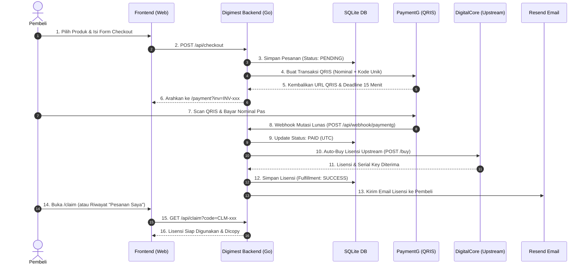

# 💎 Digimest — Platform E-Commerce Produk Digital & Lisensi Otomatis

**Digimest** (`https://digimest.tech`) adalah sistem toko online otomatisasi penjualan produk digital, serial keys, akun streaming, dan lisensi software. Sistem ini mengintegrasikan gateway pembayaran QRIS otomatis (**PaymentG**) dan penyedia stok lisensi upstream (**DigitalCore**) secara *real-time* tanpa campur tangan manusia.

---

## 🏗️ Tech Stack & Arsitektur

```
┌────────────────────────────────────────────────────────┐
│                   Frontend (Client)                    │
│   Native HTML5 • CSS3 Glassmorphism • Vanilla JS ES6   │
│       (Zero Build Step • No Node.js / NPM Required)     │
└───────────────────────────▲────────────────────────────┘
                            │ REST API / Clean URLs
┌───────────────────────────▼────────────────────────────┐
│                    Backend (Go 1.22+)                  │
│   Chi Router • Modernc SQLite (Pure Go, CGO_ENABLED=0) │
└───────┬───────────────────┬───────────────────┬────────┘
        │                   │                   │
        ▼                   ▼                   ▼
┌───────────────┐   ┌───────────────┐   ┌───────────────┐
│   PaymentG    │   │  DigitalCore  │   │  Resend.com   │
│  QRIS Gateway │   │ Upstream Stok │   │ Email Notif   │
└───────────────┘   └───────────────┘   └───────────────┘
```

* **Backend:** Bahasa pemrograman **Go (Golang) 1.22+** dengan router ringan [`go-chi/chi/v5`](https://github.com/go-chi/chi).
* **Database:** **SQLite** menggunakan driver pure Go [`modernc.org/sqlite`](https://gitlab.com/cznic/sqlite) (tidak membutuhkan GCC compiler / CGO).
* **Frontend:** **Vanilla HTML/CSS/JS** murni tanpa framework (tanpa React, Vue, Tailwind, atau bundler Node.js). Ringan, cepat dimuat, ramah SEO, dan responsif di mobile & desktop.
* **Integrasi Eksternal:**
  * **PaymentG:** Gateway QRIS ShopeePay otomatis dengan sistem pencocokan kode unik 3 digit.
  * **DigitalCore:** Provider stok lisensi digital upstream dengan bot pemenuhan instan.
  * **Resend:** Layanan transactional email untuk pengiriman serial key ke pembeli.

---

## 📐 Alur Kerja Bisnis End-to-End (*Order Lifecycle*)



### 1. Sinkronisasi Katalog & Resiliensi Cache
* Katalog produk diambil dari endpoint DigitalCore `GET /products`.
* Backend menerapkan **In-Memory Cache (RWMutex)** dengan TTL 45 detik.
* **Graceful Fallback:** Jika upstream DigitalCore mengalami gangguan jaringan (*micro-outage*) atau timeout, backend tetap menyajikan data cache terakhir tanpa membuat halaman etalase toko error.

### 2. Rumus Kalkulasi Harga Otomatis
Harga jual produk dihitung otomatis dengan formula:
$$\text{Harga Jual IDR} = \text{RoundTo100}\left((\text{Harga USD} \times \text{Kurs}) \times (1 + \frac{\text{Margin}\%}{100}) + \text{Margin Tetap}\right)$$
* **Override Kustom:** Jika admin menetapkan harga khusus (*Custom Reference Price*) atau harga diskon (*Promo Price*) di menu admin, harga override yang digunakan.
* **Proteksi Lonjakan Modal (Surge Protection):** Jika modal upstream naik $\le$ persentase batas (default 50%), harga passthrough menyesuaikan. Jika modal naik melebihi batas tersebut secara ekstrem, produk **otomatis di-suspend** agar toko tidak rugi.

### 3. Pembuatan Pesanan & Masa Berlaku
* Nomor invoice memiliki format entropi tinggi: `INV-YYYYMMDD-XXXXXX` (6 karakter acak).
* Kode klaim rahasia: `CLM-XXXXXX`.
* Kode unik transfer acak: 3 digit angka (100–999).
* Masa berlaku pesanan: **15 menit**. Background worker (`SweepExpiredOrders`) membersihkan pesanan yang belum dibayar setiap 1 menit berdasarkan waktu UTC yang presisi.

### 4. Pencegahan Loop & Idempotensi Finansial
* Halaman klaim (`/claim`) memutus loop redirect untuk pesanan yang kadaluarsa/dibatalkan.
* Pesanan yang berstatus **`REFUNDED`** dilindungi secara mutlak: tidak dapat dibeli ulang ke DigitalCore baik via webhook susulan, *Retry Fulfillment*, maupun *Force Fulfill*.

---

## 🗄️ Skema Database SQLite

Database disimpan pada file `storeku.db` (diaktifkan mode WAL dan `busy_timeout = 5000ms`).

### 1. Tabel `orders` (Data Transaksi & Lisensi)
| Kolom | Tipe | Deskripsi |
| :--- | :--- | :--- |
| `id` | INTEGER PK | Auto-increment ID |
| `invoice_number` | TEXT UNIQUE | Nomor invoice (`INV-20261011-ABCDEF`) |
| `claim_code` | TEXT UNIQUE | Kode rahasia klaim produk (`CLM-ABCDEF`) |
| `product_slug` | TEXT | Slug produk dari DigitalCore |
| `product_name` | TEXT | Nama produk |
| `quantity` | INTEGER | Jumlah item yang dibeli |
| `base_price_usd` | REAL | Harga modal upstream saat checkout |
| `sell_price_idr` | INTEGER | Harga satuan per item (IDR) |
| `original_amount` | INTEGER | Subtotal tanpa kode unik |
| `unique_code` | INTEGER | Kode unik transaksi 3 digit |
| `total_amount` | INTEGER | Total nominal pembayaran yang harus ditransfer |
| `gateway_order_id`| TEXT | ID transaksi dari PaymentG |
| `qr_url` | TEXT | URL gambar QRIS dinamis |
| `payment_status` | TEXT | `PENDING`, `PAID`, `EXPIRED`, `CANCELLED`, `REFUNDED` |
| `fulfillment_status`| TEXT | `PENDING`, `SUCCESS`, `FAILED`, `REFUNDED` |
| `digitalcore_order_id`| TEXT | ID order pembelian di DigitalCore |
| `delivered_items` | TEXT (JSON) | Array lisensi / serial keys (contoh: `["KEY-1", "KEY-2"]`) |
| `customer_email` | TEXT | Email pembeli untuk notifikasi Resend |
| `customer_contact` | TEXT | Kontak alternatif / nomor HP pembeli |
| `paid_at` | DATETIME | Waktu pelunasan (UTC) |
| `expires_at` | DATETIME | Batas waktu pembayaran (UTC) |
| `created_at` | DATETIME | Waktu pembuatan pesanan (UTC) |

### 2. Tabel `settings` (Konfigurasi Global Toko)
Menyimpan konfigurasi key-value:
* `usd_rate`: Nilai kurs 1 USD ke IDR (contoh: `18000`).
* `margin_percent`: Persentase keuntungan (contoh: `25` untuk 25%).
* `margin_fixed`: Biaya operasional tetap per item (contoh: `2000`).
* `max_surge_disable_percent`: Ambang lonjakan modal upstream sebelum produk disuspend (contoh: `50`).
* `telegram_cs_username`: Username akun Telegram CS (contoh: `Digimestsupport`).

### 3. Tabel `product_overrides` (Kustomisasi Produk)
* `product_slug` (PK): Slug produk.
* `custom_name`, `custom_description`, `custom_terms`: Teks kustomisasi tampilan.
* `custom_price_idr`: Harga jual tetap kustom (mengabaikan rumus kurs jika diset).
* `promo_price_idr`: Harga promo diskon.
* `is_active`: `1` (tampil di katalog) atau `0` (disembunyikan).
* `is_force_out_of_stock`: `1` (paksa stok habis manual oleh admin).

---

## 📡 Referensi API Endpoints

### Public Store API
* `GET /health` — Health check endpoint.
* `GET /api/config` — Mengambil konfigurasi publik (username & URL Telegram CS).
* `GET /api/products` — Mengambil katalog produk aktif dengan harga terhitung dan status promo.
* `GET /api/products/{slug}` — Mengambil rincian produk tunggal.
* `POST /api/checkout` — Membuat pesanan baru dan menghasilkan pembayaran QRIS PaymentG.
* `GET /api/orders/{invoice}/status` — Mengecek status pembayaran dan batas kedaluwarsa.
* `POST /api/orders/{invoice}/check` — Memeriksa mutasi instan (*Saya Sudah Bayar*, throttled 1 req / 4 detik).
* `POST /api/orders/{invoice}/cancel` — Membatalkan pesanan pending.
* `GET /api/claim?code={code}` — Mengambil lisensi produk menggunakan invoice number atau claim code.

### Webhook API
* `POST /api/webhook/paymentg` — Menerima webhook mutasi pembayaran lunas dari PaymentG (idempotent, return HTTP 200 OK).

### Admin API (Protected via Cookie Session)
* `POST /api/admin/login` — Login admin (`ADMIN_SECRET_KEY`).
* `POST /api/admin/logout` — Logout dan hapus cookie session.
* `GET /api/admin/stats` — Statistik pesanan, omset, dan sisa saldo DigitalCore.
* `GET /api/admin/products` — Daftar seluruh produk upstream beserta modal dan status suspend.
* `POST /api/admin/products/{slug}` — Menyimpan kustomisasi harga, diskon promo, atau force out of stock.
* `POST /api/admin/products/{slug}/reset` — Mereset kustomisasi produk kembali ke default formula.
* `GET /api/admin/orders` — Riwayat seluruh pesanan dengan filter status dan pagination.
* `POST /api/admin/retry` — Mencoba ulang auto-buy ke DigitalCore jika saldo bot sempat kosong.
* `POST /api/admin/orders/{invoice}/force-fulfill` — Membeli paksa ke DigitalCore.
* `POST /api/admin/orders/{invoice}/manual-paid-fulfill` — [Dinonaktifkan / HTTP 403] Demi integritas dan keselamatan transaksi.
* `POST /api/admin/orders/{invoice}/mark-refunded` — Menandai pesanan telah di-refund manual.
* `GET /api/admin/last-login` — Mengambil waktu (WIB), IP, lokasi, dan riwayat login admin.
* `GET /api/admin/settings` — Membaca pengaturan kurs, margin, dan Telegram CS.
* `POST /api/admin/settings` — Memperbarui pengaturan kurs, margin, dan Telegram CS.

---

## ⚠️ Batasan Teknis & Aturan Penting (*Rules for Next Agent*)

Jika Anda adalah agen AI atau developer yang melanjutkan pengembangan sistem ini, patuhi aturan berikut:

1. **Plaintext Password di `.env` (SENGAJA):**
   > [!IMPORTANT]
   > Kredensial login admin (`ADMIN_SECRET_KEY` atau `ADMIN_PASSWORD`) disimpan dalam format teks mentah (*plaintext*) di `.env` secara **SENGAJA** sesuai permintaan pemilik sistem. Jangan mengubahnya menjadi hashing bcrypt kompleks tanpa instruksi eksplisit dari pengguna.

2. **Normalisasi Waktu Wajib UTC:**
   > [!WARNING]
   > Driver SQLite membandingkan string waktu secara alfabetis. Seluruh penulisan dan pembacaan waktu kedaluwarsa (`expires_at`, `paid_at`, dan sweeper query) **WAJIB** menggunakan `time.Now().UTC()`. Jangan pernah menggunakan waktu lokal mesin.

3. **Konkurensi Database SQLite (Single Writer):**
   * Gunakan `db.SetMaxOpenConns(1)` dengan pragma `WAL mode` untuk mencegah error *database is locked*.
   * Selalu gunakan transaksi atau query langsung tanpa membuka multi-connection writer.

4. **Kemandirian Frontend (Zero Build Step):**
   * Seluruh kode HTML, CSS, dan JS di folder `web/` harus tetap berjalan secara langsung di browser tanpa memerlukan langkah *compile* atau `npm run build`.
   * Endpoint API pada frontend menggunakan modul modular [`web/js/api-config.js`](file:///C:/laragon/www/storeku/web/js/api-config.js).

5. **Proteksi SEO & Crawler:**
   * File [`web/robots.txt`](file:///C:/laragon/www/storeku/web/robots.txt) melarang pengindeksan direktori `/admin/`, `/payment`, dan `/api/`. Pertahankan aturan ini saat menambahkan endpoint baru.

---

## 🚀 Panduan Menjalankan & Mengembangkan

### 1. Menjalankan Unit Tests
```bash
go test -count=1 -v ./...
```

### 2. Menjalankan Server Lokal (Development)
```bash
go run ./cmd/server
```
Server akan aktif di: `http://localhost:8080`
* Etalase Toko: `http://localhost:8080/`
* Halaman Klaim: `http://localhost:8080/claim`
* Panel Admin: `http://localhost:8080/admin` (Login menggunakan value `ADMIN_SECRET_KEY` dari `.env`)

### 3. Kompilasi Binary Produksi (Linux VPS amd64)
```bash
# Windows PowerShell
$env:CGO_ENABLED = "0"; $env:GOOS = "linux"; $env:GOARCH = "amd64"
go build -ldflags="-s -w" -o storeku-linux ./cmd/server

# Linux Terminal
CGO_ENABLED=0 GOOS=linux GOARCH=amd64 go build -ldflags="-s -w" -o storeku-linux ./cmd/server
```

### 4. Panduan Deployment & Hosting
Untuk panduan hosting menggunakan **Cloudflare Tunnel** (tanpa Nginx dan tanpa port forwarding), silakan baca file [`HOSTING.md`](file:///C:/laragon/www/storeku/HOSTING.md).

---

## 📁 Struktur Direktori Repositori

```
storeku/
├── cmd/
│   └── server/
│       └── main.go                 # Entry point backend & HTTP router Chi
├── internal/
│   ├── config/
│   │   └── config.go               # Parser konfigurasi .env
│   ├── database/
│   │   ├── db.go                   # Inisialisasi SQLite connection pool & pragmas
│   │   └── migrations.go           # Migrasi skema tabel & indeks
│   ├── handler/
│   │   ├── admin_handler.go        # Controller panel admin & otentikasi
│   │   ├── middleware.go           # CORS & Admin JWT cookie auth middleware
│   │   ├── public_handler.go       # Controller etalase, checkout, claim & throttling
│   │   └── webhook_handler.go      # Controller penerima webhook PaymentG
│   ├── models/
│   │   └── models.go               # Struct model Go (Order, Product, Settings)
│   ├── repository/
│   │   ├── order_repo.go           # Query database SQLite tabel orders
│   │   ├── product_override_repo.go# Query kustomisasi produk
│   │   └── setting_repo.go         # Query konfigurasi key-value
│   └── service/
│       ├── digitalcore_client.go   # Client upstream API DigitalCore & cache 45s
│       ├── order_service.go        # Business logic pesanan, idempotensi, & fulfillment
│       ├── order_service_test.go   # Unit test alur bisnis & proteksi refund
│       ├── paymentg_client.go      # Client gateway QRIS PaymentG
│       ├── pricing_service.go      # Logika kurs, margin, promo & surge protection
│       └── resend_service.go       # Layanan kirim email serial key via Resend
├── web/                            # Frontend statis
│   ├── admin/                      # Halaman panel admin (index, login, products, orders, settings)
│   ├── css/                        # Stylesheet (style.css, admin.css)
│   ├── js/                         # Script frontend (catalog, checkout, payment, claim, admin)
│   ├── logo/                       # Aset logo & icon Digimest
│   ├── index.html                  # Halaman etalase utama
│   ├── product.html                # Halaman detail produk
│   ├── payment.html                # Halaman pembayaran QRIS & hitung mundur
│   ├── claim.html                  # Halaman klaim lisensi & riwayat
│   └── robots.txt                  # Kebijakan perayap bot mesin pencari
├── .env.example                    # Template variabel lingkungan
├── HOSTING.md                      # Panduan hosting simpel via Cloudflare Tunnel
├── README.md                       # Dokumentasi teknis & handover agen AI
└── storeku.db                      # Database SQLite aktif (fresh, 0 rows)
```
